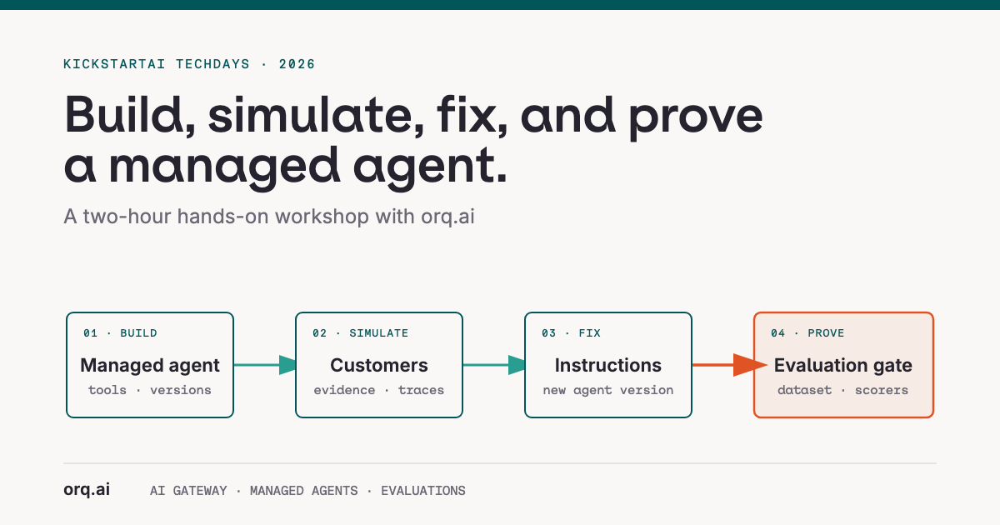

<p align="center">
  
</p>

# KickstartAI TechDays

Hands-on KickstartAI TechDays material for a refund agent hosted in [orq.ai](https://orq.ai). You simulate customers against version 1, find what it gets wrong, fix the prompt, publish version 2, and prove the fix with a regression eval on an orq.ai dataset.

Docs site: **https://orq-ai.github.io/kickstarterai-techdays-workshop-2026**

<p align="center">
  
</p>

The chat UI you run locally (`make agent-chat-ui`): ask the refund agent for a refund, see which tools it called, and open the trace in orq.ai.

## Quickstart

You need [uv](https://docs.astral.sh/uv/), `git`, `make` and the [orq.ai CLI](https://docs.orq.ai/reference/cli). Your key, project and seat prefix come by email on the day.

```bash
git clone https://github.com/orq-ai/kickstarterai-techdays-workshop-2026
cd kickstarterai-techdays-workshop-2026
make setup                          # uv sync, .env from the example
# paste the block from your kickstart email into .env
make orq-doctor gateway-check
```

Then follow the docs site, or `make help` for every target in order.

## The flow

| Page | Folder | You run |
|---|---|---|
| Onboarding | `modules/00-onboarding` | `make setup orq-doctor gateway-check`; the gateway from curl, CLI and Python |
| Coding agents (optional) | `modules/01-coding-agents` | orqi, or the orq.ai plugin in your own agent |
| Build a Managed Agent | `modules/02-refund-agent` | hello agent, `make seed-workspace`, `make invoke-agent`, first trace |
| Simulation | `modules/03-simulation` | `make simulate-agent`, `make evaluatorq-dashboard` |
| Improve and Evaluate | `modules/04-fix-and-eval` | `make publish-agent-version`, `make compare-versions`, `make regression-eval` |

`main` holds the exercises with TODOs. The public `solution` branch has the same files completed; look at one file without switching branches: `git show origin/solution:modules/03-simulation/run.py`.

## Go further

For broader platform topics (AI Gateway, guardrails, tracing, knowledge bases, MCP, trace insights, and red teaming), see the [official orq.ai documentation](https://docs.orq.ai/).

## License

MIT, see `LICENSE`.
