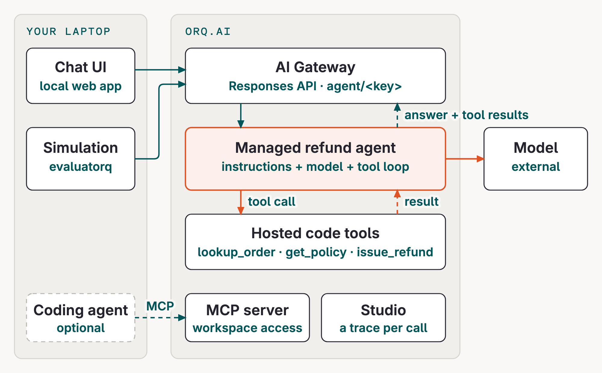

# Is your agent behaving like you expect?

**KickstartAI TechDays · 15 October 2026.** Build one refund agent in orq.ai, simulate customer conversations, improve its instructions, and prove the result with a regression eval.

[Start with onboarding](modules/00.md){ .md-button .md-button--primary }
[Cheat sheet](reference/cheat-sheet.md){ .md-button }

## How the pieces fit

Your chat UI and simulation run on your laptop and call the AI Gateway. orq.ai runs the [managed refund agent](https://my.orq.ai/kickstartai-workshop-2026/agents)'s model loop and its three [code tools](https://my.orq.ai/kickstartai-workshop-2026/tools), then returns the answer and tool results. Every call leaves a [trace in the Studio](https://my.orq.ai/kickstartai-workshop-2026/traces). Your coding agent can also use the orq.ai MCP server to work with your workspace.



## Requirements

You need a laptop with Python 3.11–3.13, `git`, `make`, and [uv](https://docs.astral.sh/uv/). Install the [orq.ai CLI](https://docs.orq.ai/reference/cli) for inspection and quick API reproduction.

```bash {.terminal}
# Clone once. `make setup` runs `uv sync --all-groups`.
git clone https://github.com/orq-ai/kickstarterai-techdays-workshop-2026
cd kickstarterai-techdays-workshop-2026
make setup
```

`make setup` installs the pinned workshop runtime from [`pyproject.toml`](https://github.com/orq-ai/kickstarterai-techdays-workshop-2026/blob/main/pyproject.toml):

| Package | Why |
|---|---|
| [`orq-ai-sdk`](https://github.com/orq-ai/orq-python) | Create and version orq.ai resources; invoke managed agents from Python |
| [`openai`](https://github.com/openai/openai-python) | OpenAI-compatible client used for router and evaluatorq calls |
| [`evaluatorq`](https://github.com/orq-ai/evaluatorq) | Simulations, dataset jobs, scorers, and `eq dashboard` |

You do **not** need to install these packages individually with `pip`; `uv` uses the repository lockfile for the tested versions. Your orq.ai key, project, workspace, and seat prefix arrive by email on the day after you scan the QR code on the first slide.

## Official resources

- [orq.ai documentation](https://docs.orq.ai/): Agents, AI Gateway, tools, evaluators, experiments, and observability
- [orq.ai Python SDK](https://github.com/orq-ai/orq-python): the `orq_ai_sdk` package used by this workshop
- [orq.ai CLI reference](https://docs.orq.ai/reference/cli): install and command reference
- [evaluatorq documentation](https://orq-ai.github.io/evaluatorq/): simulations, jobs, evaluators, and dashboards
- [evaluatorq on GitHub](https://github.com/orq-ai/evaluatorq): source, examples, and issue tracker

## Learning path

| Module | Focus | What you do | Page |
|---|---|---|---|
| Onboarding | Gateway access and traces | Make one model request and inspect its trace | [Onboarding](modules/00.md) |
| Coding agents (optional) | Assistant setup | Connect orqi, Claude Code, or another MCP client when you need one | [Coding agents](modules/01.md) |
| Build a Managed Agent | Managed agent fundamentals | Run hello, seed the refund agent, finish the Python call, inspect its trace | [Build a Managed Agent](modules/02.md) |
| Simulation | Conversation evidence | Define cases and inspect judged transcripts | [Simulation](modules/03.md) |
| Improve and Evaluate | Versioned improvement | Publish, replay, simulate, and gate a new version | [Improve and Evaluate](modules/04.md) |

**First-hour checkpoint:** one gateway request with a trace, a working hello agent, and a refund agent whose Python client prints tool results and a trace ID. You do not need the coding-agent installation, a second model, the chat UI, or all three API interfaces to reach that checkpoint. Install dependencies and prepare your key before the session if possible.

## Go further

For broader platform topics (AI Gateway, guardrails, tracing, knowledge bases, MCP, trace insights, and red teaming), see the [official orq.ai documentation](https://docs.orq.ai/).
