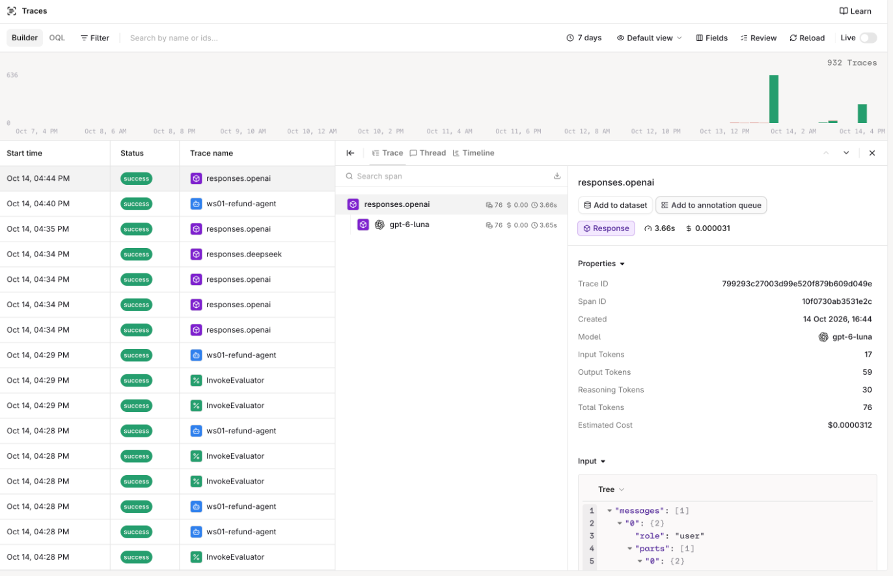
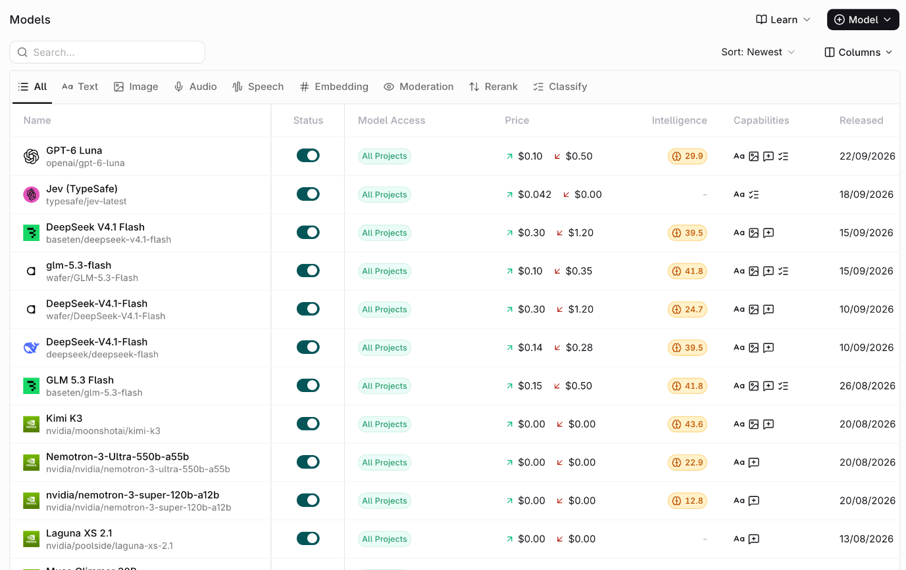

# Onboarding

| | |
|---|---|
| **Prerequisites** | a laptop with [uv](https://docs.astral.sh/uv/), `git`, `make`, and the [orq.ai CLI](https://docs.orq.ai/reference/cli) |
| **You will have** | a working gateway request using the workshop key, plus its trace in Studio |

## Why

Every model call today, yours and the agent's, goes through the **orq.ai AI Gateway**: one OpenAI-compatible endpoint in front of every model the workspace has enabled. One key, one base URL, and each call becomes a trace with its cost, tokens and latency. Before anything else, check that this works with your key.

## Steps

### Step 1 · Get your key

1. Scan the QR code on the slide, or open the kickstart page the hosts show.
2. Enter your email and the passcode on the slide.
3. Open the email. It holds a ready-to-paste block: `ORQ_API_KEY`, `ORQ_PROJECT`, `WS_PREFIX` and `ORQ_WORKSPACE`.

### Step 2 · Clone and configure

```bash {.terminal}
git clone https://github.com/orq-ai/kickstarterai-techdays-workshop-2026
cd kickstarterai-techdays-workshop-2026

uv sync --all-groups                   # install dependencies
test -f .env || cp .env.example .env   # create your config on a fresh clone
```

`make setup` does both of these.

Paste the block from the email over the empty lines at the top of `.env`. The model lines below them are already filled in; leave them.

**In every new terminal**, load `.env` so `orq` and `curl` can read it (Python scripts load it themselves):

```bash {.terminal}
set -a
source .env
set +a
```

Install the orq.ai CLI if `orq --version` says command not found. Skip the installer's login step: the workshop uses your key from `.env`, not a saved session.

```bash {.terminal}
curl -fsSL https://cli.orq.ai/install.sh | sh -s -- --no-setup
# or, with Node 14+ (the only route on Windows):
npm install -g @orq-ai/cli
```

If `orq` is still not found after the installer, it landed in `~/.orq/bin`: add that folder to your `PATH` or open a new terminal.

Check that the CLI uses your workshop key:

```bash {.terminal}
orq whoami
```

Look for `source: ORQ_API_KEY`. If you see another source (such as a saved `orq auth login` session) or an error, run `make orq-doctor`: it runs `orq whoami` and `orq doctor` with `.env` exported.

### Step 3 · Make one gateway request

A model ID has the form `provider/model`. This script makes one OpenAI-compatible Responses API call with the `MODEL` from your `.env` and prints its trace ID:

```bash {.terminal}
uv run python -m app.gateway_check
```

`make gateway-check` does the same. Look for `verdict : OK` and save the trace ID.

Example output (your model, answer, tokens and trace ID can differ):

<!-- termynal -->

```console
$ uv run python -m app.gateway_check
── Gateway check · one request through the gateway ───────
endpoint : https://my.orq.ai/v3/router/responses
model    : wafer/GLM-5.3-Flash
answer   : An AI gateway sits between applications and AI models
           to manage and secure requests, ...
tokens   : 17 in, 48 out
trace    : 74c18139baffe8399c6029823b037995
verdict  : OK, your key and the gateway work
```

### Step 4 · Find that trace

Open the [workshop workspace](https://my.orq.ai/kickstartai-workshop-2026), select the project named by `ORQ_PROJECT` in your email, then open [**Observability** > **Traces**](https://my.orq.ai/kickstartai-workshop-2026/traces) and find the ID from Step 3. Check the model, response, tokens, cost, and latency. That is the same evidence you will later use to inspect an agent turn.



### Optional · Browse models and try other interfaces

In [**AI Gateway** > **Models**](https://my.orq.ai/kickstartai-workshop-2026/router/models), the Model Garden lists the models available to this workspace. The model ID in `.env` is your starting point; the provider, capabilities, and price help you choose another. Comparing models is useful, but not required before creating the agent.



The same list from the terminal (requires `jq`):

```bash {.terminal}
orq models list -o json |
  jq -r '
    .[]
    | select(.enabled)
    | "\(.provider)/\(.model_id)  \(.model_type)"
  '
```

The same request, three ways. Pick one or skip them; the script above already made it.

=== "curl"

    ```bash {.terminal}
    curl -s https://my.orq.ai/v3/router/responses \
      -H "Authorization: Bearer $ORQ_API_KEY" \
      -H "Content-Type: application/json" \
      --data "{
        \"model\": \"$MODEL\",
        \"input\": \"In one sentence: what does an AI gateway do?\"
      }" \
      -D - |
      grep -i x-orq-trace-id
    ```

=== "orq.ai CLI"

    ```bash {.terminal}
    orq responses create \
      --model "$MODEL" \
      --input '"In one sentence: what does an AI gateway do?"' \
      -o json
    ```

=== "Python"

    ```python {.code-frame}
    from openai import OpenAI

    from app.refund_agent.config import settings  # loads .env

    client = OpenAI(api_key=settings.api_key, base_url=settings.router_url)
    raw = client.responses.with_raw_response.create(
        model=settings.model,
        input="In one sentence: what does an AI gateway do?",
    )
    print(raw.parse().output_text)
    print(raw.headers.get("x-orq-trace-id"))
    ```

### Optional · Compare another model

Pick another chat model from the Model Garden and send the same request; only the model id changes:

```bash {.terminal}
uv run python -m app.gateway_check deepseek/deepseek-flash
```

Compare the two trace IDs in **Observability** > **Traces**. The model, tokens, cost, and latency will differ.

## Gotchas

- **401 API key is not valid.** The key in `.env` has a typo or a trailing space, or your shell exports an older `ORQ_API_KEY`. Paste the block again, then rerun the environment command from Step 2 before using curl or the CLI.
- **400 invalid model.** The model id has no provider, or is not enabled in the workspace. Copy it from the Model Garden as `provider/model`.

## Official docs

- [AI Gateway](https://docs.orq.ai/ai-gateway/get-started/introduction): one endpoint in front of every model
- [Models (Model Garden)](https://docs.orq.ai/ai-gateway/using-the-router): browse and enable models, `provider/model` ids
- [OpenAI-compatible API](https://docs.orq.ai/ai-gateway/features/openai-compatible-api): the OpenAI SDK with orq.ai's base URL
- [Responses API](https://docs.orq.ai/ai-gateway/features/responses-api): the endpoint every call today uses
- [API keys](https://docs.orq.ai/ai-studio/organization/api-keys): project-scoped keys, like the one in your email
- [Traces](https://docs.orq.ai/ai-studio/observability/traces): what each call records
- [orq.ai CLI](https://docs.orq.ai/reference/cli): `orq whoami`, `orq models`, `orq responses`

## Done when

`uv run python -m app.gateway_check` prints a trace id and `verdict : OK`, and you have found that trace in the Studio.
