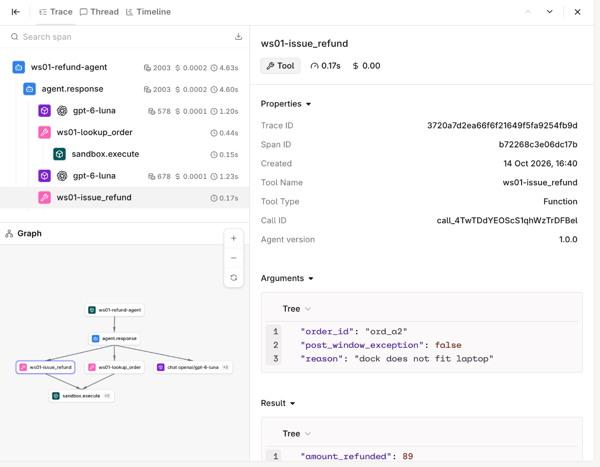
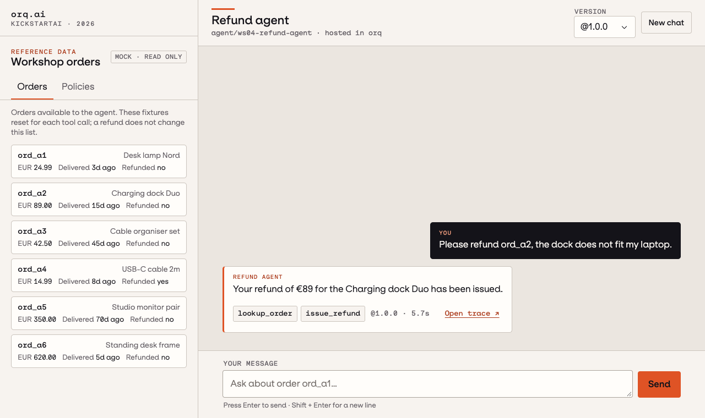

# Build the Agent

| | |
|---|---|
| **Prerequisites** | onboarding done |
| **You will have** | a versioned refund agent with three hosted code tools, one completed Python call, and an inspected trace |

## Why

The refund agent is a fully managed, versioned orq.ai agent: your app sends one message and gets one response, while orq.ai runs both the model loop and the code tools. The tools come from [`app/refund_agent/tools.py`](https://github.com/orq-ai/kickstarterai-techdays-workshop-2026/blob/main/app/refund_agent/tools.py); instructions come from [`app/data/instructions.md`](https://github.com/orq-ai/kickstarterai-techdays-workshop-2026/blob/main/app/data/instructions.md).

Foundations covers the generic agent loop; [Use Case](https://orq-ai.github.io/kickstarterai-techdays-workshop-2026/modules/02-logic/) defines the refund requirements and [Agent Design](https://orq-ai.github.io/kickstarterai-techdays-workshop-2026/modules/02-solution-design/) shows the v1 approach.

## Steps

### Step 1 · Create the refund agent

Run this once. Everything it creates starts with your seat prefix (`ws07-…`), so your resources stay separate from other participants'. It is safe to run again: it only creates what is missing and never changes an existing agent. `make seed-workspace` runs `uv run python -m app.refund_agent.entities seed`.

Example session (your seat prefix and entity IDs will differ):

<!-- termynal -->

```console
$ make seed-workspace
── Seed · create this seat's agent ───────────────────
seat     : ws07 → <your project>/workshop
tools    : ws07-lookup_order, ws07-issue_refund, ws07-get_policy (code tools, run by orq.ai)
agent    : ws07-refund-agent v1.0.0
```

It refuses to run with an empty or made-up `WS_PREFIX`. `uv run python -m app.refund_agent.entities reset` deletes your seat's entities, and only those.

### What this command creates

The seed script reads the local agent sources and creates the matching orq.ai resources:

| Local source | Resource created in orq.ai |
|---|---|
| [`app/refund_agent/tools.py`](https://github.com/orq-ai/kickstarterai-techdays-workshop-2026/blob/main/app/refund_agent/tools.py) | Three hosted code tools |
| [`app/data/instructions.md`](https://github.com/orq-ai/kickstarterai-techdays-workshop-2026/blob/main/app/data/instructions.md) | The first refund-agent version |

Afterward, the chat UI and scripts use the resource keys. They invoke the managed agent; they do not run the tool implementation on your laptop. The dataset and policy judge come later, in Improve and Evaluate.

??? info "Optional: Inspect the SDK calls and agent settings"
    **The SDK calls behind seed**

    `ensure_tools()` creates each hosted code tool from the local Python source. `ensure_agent()` attaches those tool keys to the managed agent.

    ```python {.code-frame}
    # app/refund_agent/entities.py: one hosted code tool per schema
    orq.tools.create(
        request={
            "type": "code",
            "key": settings.key(function["name"]),
            "path": settings.path,
            "description": function["description"],
            "code_tool": {
                "language": "python",
                "code": hosted_tool_code(function["name"]),
                "parameters": strict_parameters(function),
            },
        },
    )
    ```

    **What seed configures**

    | Setting | v1 value | Why it matters |
    |---|---|---|
    | Model | `settings.model` from `MODEL` in `.env` | The workshop can choose a model without editing module code. |
    | Reasoning effort | `none` | Required by the selected model when it uses hosted code tools. |
    | Maximum iterations | `8` | Caps model/tool-loop turns. |
    | Maximum execution time | `120` seconds | Caps the entire managed-agent run. |
    | Tools | three hosted `code` tools | orq.ai executes the order, policy, and refund code. |
    | Versioning | major increments on publish | Pins a complete agent configuration for comparison. |

    ```python {.code-frame}
    # app/refund_agent/entities.py
    orq.agents.create(
        key=settings.agent_key,
        instructions=agent_instructions(),
        path=settings.path,
        model={
            "id": settings.model,
            "parameters": {"reasoning_effort": "none"},
        },
        settings={
            "max_iterations": 8,
            "max_execution_time": 120,
            "tools": [
                {"type": "code", "key": tool_key}
                for tool_key in tool_keys
            ],
        },
    )
    ```

### Step 2 · Read the resources in the Studio

Open [**Agents** in the workshop workspace](https://my.orq.ai/kickstartai-workshop-2026/agents), search for your `WS_PREFIX`, and open `-refund-agent`. Everything below is read-only; the full v1 instructions are left for the Improve and Evaluate module, after Agent Simulation.

| Where in the Studio | What to check |
|---|---|
| **Settings** tab of the agent | The role and description, the model, and three attached tools: `lookup_order`, `issue_refund` and `get_policy`. |
| **Versions** tab | A single version, v1.0.0. The limits show up here after your first call. |
| **Tools** → `issue_refund` → **Tool Definition** | The Python that orq.ai runs, generated from [`tools.py`](https://github.com/orq-ai/kickstarterai-techdays-workshop-2026/blob/main/app/refund_agent/tools.py). |

**Code-tool view: read the executable policy.** The schema is what the model may request; the Python is what orq.ai actually executes. Open `issue_refund` and read it top to bottom:

1. A header comment: the code is generated by `make seed-workspace`, and orq.ai passes the call's arguments in `params`.
2. Three constants: the 30-day window, the EUR 500 limit and the allowed post-window reasons.
3. `_FIXTURE`, the sample orders. It is long, so scroll past it; it is visible on purpose, so you can tell example data from enforcement logic.
4. `OrderStore`, which decides whether an order belongs to the signed-in customer.
5. `issue_refund(...)`: the ordered early returns (`not_found`, `already_refunded`, `above_limit_needs_human_review`, `outside_window`, `reason_not_in_exception_list`) and then the successful result. This is the part that decides.
6. The last line calls it with `params` and leaves the outcome in `result`.

### Step 3 · Inspect and call it from Python

Open [`modules/02-refund-agent/run.py`](https://github.com/orq-ai/kickstarterai-techdays-workshop-2026/blob/main/modules/02-refund-agent/run.py). Complete these two TODOs before you run it:

| TODO | Where | What to implement | Done when |
|---|---|---|---|
| 1 | `response = None` | Call `orq.responses.create()` with `model=f"agent/{settings.agent_key}"` and `input=QUESTION`. | The script reaches the output-item loop instead of stopping with `TODO 1`. |
| 2 | The `for item in response...` loop | Add the branch for an item whose type starts with `orq:` and print its `name` and `result`. | Every `call` line in the output has a matching `result` line. |

Do not change the inspection code or the message branch. The exercise is about seeing the raw Responses API output shape: request items, managed tool results, final message, and trace ID.

Run `make invoke-agent` (or `uv run python modules/02-refund-agent/run.py`). Expected session once the TODOs are done; your seat, model, answer and trace ID can differ:

<!-- termynal -->

```console
$ make invoke-agent
uv run python modules/02-refund-agent/run.py
── Step 1 · Inspect the agent ─────────────────────────
agent    : ws07-refund-agent v1.0.0
model    : <configured model>
tools    : ws07-lookup_order, ws07-issue_refund, ws07-get_policy
limits   : max_iterations 8, max_execution_time 120s
── Step 2 · Call it and read the output items ─────────
question : Please refund ord_a2, the dock does not fit my laptop.
call     : ws07-lookup_order({"order_id":"ord_a2"})
result   : ws07-lookup_order -> {"ok": true, "order": {"id": "ord_a2", "amount": 89.0, "item": "Charging dock Duo", "delivered_days_
call     : ws07-issue_refund({"order_id":"ord_a2","reason":"dock does not fit laptop","post_window_exception":false})
result   : ws07-issue_refund -> {"ok": true, "order_id": "ord_a2", "amount_refunded": 89.0, "currency": "EUR"}
answer   : Your refund of €89 for order ord_a2 has been issued to your original payment method.
trace    : <your trace id>
next     : open the trace in the Studio; the tool spans ran in orq.ai, not on your laptop
```

Each `call` line is what the model asked for; each `result` line is what the tool did. Find the trace ID under **Observability** > **Traces** to see the same calls.



### Optional · Chat with the agent

```bash {.terminal}
uv run python -m app.web
# Then open http://127.0.0.1:8002
```

This starts the local chat application. `make agent-chat-ui` is its shortcut.

The **Workshop orders** panel shows the read-only data the code tools were built from: **Orders** (what `lookup_order` and `issue_refund` see) and **Policies** (what `get_policy` returns). On a small screen, open it with **Reference data**. In the chat, choose one of the welcome prompt cards or write your own. Each answer shows a chip per tool call and an **Open trace** link.



### Optional · Call through Python, curl or the CLI

=== "Python SDK"

    Use this in application code. `ask_agent()` is the workshop helper: it makes the call and gives you the answer, tool calls, results and trace ID.

    ```python {.code-frame}
    from app.refund_agent.client import ask_agent

    turn = ask_agent(
        "Refund ord_a1, I changed my mind.",
        version="1.0.0",  # pin the version
    )

    print(turn.answer)
    for call in turn.tool_calls:
        print(call.name, call.arguments, call.result)
    print(turn.trace_id)
    ```

=== "curl"

    Use this to inspect the raw Responses API request and raw output items. It assumes you completed the once-per-terminal environment setup in Onboarding.

    ```bash {.terminal}
    curl -s https://my.orq.ai/v3/router/responses \
      -H "Authorization: Bearer $ORQ_API_KEY" \
      -H "Content-Type: application/json" \
      --data "{
        \"model\": \"agent/${WS_PREFIX}-refund-agent@1.0.0\",
        \"input\": \"Refund ord_a1, I changed my mind.\"
      }" \
      | jq '.output[] | {type, name, call_id, arguments, result}'
    ```

=== "orq.ai CLI"

    Use this to reproduce the same request quickly from a terminal without writing a script.

    ```bash {.terminal}
    orq responses create \
      --model "agent/${WS_PREFIX}-refund-agent@1.0.0" \
      --input '"Refund ord_a1, I changed my mind."' \
      -o json
    ```

All three send the same request; add `@1.0.0` to the model to pin a version.

## Official docs

- [Build Agents](https://docs.orq.ai/ai-studio/ai-engineering/build-agents): instructions, model, tools, versions
- [Create Tools](https://docs.orq.ai/ai-studio/ai-engineering/create-tools): Python (code) tools, HTTP and function tools
- [Run Agents](https://docs.orq.ai/ai-studio/ai-engineering/run-agents): `agent/<key>` on the Responses API, from Python, curl and the CLI
- [orq.ai Python SDK](https://github.com/orq-ai/orq-python): the `orq_ai_sdk` package and API examples
- [Responses API](https://docs.orq.ai/ai-gateway/features/responses-api): output items, streaming, conversation state
- [Traces](https://docs.orq.ai/ai-studio/observability/traces): the agent's spans and tool calls

## Done when

`make invoke-agent` prints every tool call with its result, and you have inspected its trace in Studio. The chat UI and other API surfaces are optional.

The completed [solution script](https://github.com/orq-ai/kickstarterai-techdays-workshop-2026/blob/solution/modules/02-refund-agent/run.py) is on the `solution` branch.
