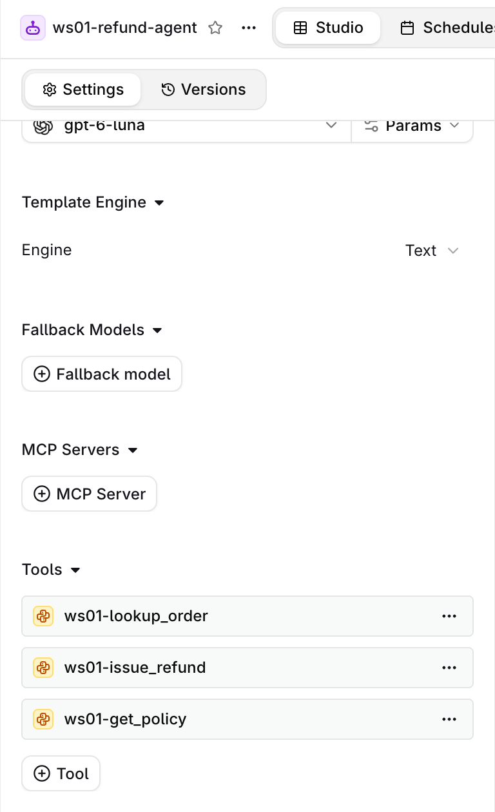
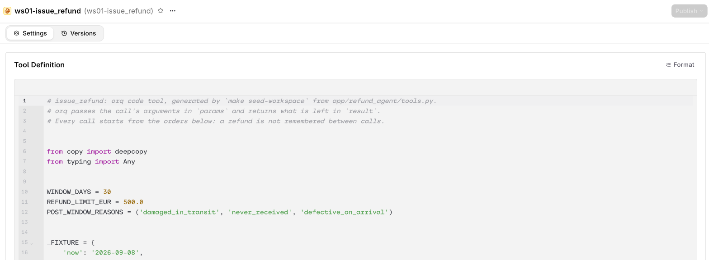

# Refund agent

| | |
|---|---|
| **Time** | 20 min |
| **Prerequisites** | onboarding done |
| **You will have** | your own refund agent at v1.0.0 with three code tools, talked to it in a browser, called it from Python, curl and the CLI, and read one trace |

## Why

In onboarding you called a model through the gateway. An agent is one step up: a model with instructions and tools, running a loop until it has an answer. The refund agent for Lumen Goods is 100 % managed: instructions, model, three tools and limits are one entity in orq, with versions. Your laptop sends a message; orq runs the model loop *and* the tools, and returns every tool call with its result. That is also what makes it testable from the outside, which the next two modules do.

| Tool | What it does |
|---|---|
| `lookup_order(order_id)` | one of the logged-in customer's orders; another customer's order is `not_found` |
| `get_policy(topic)` | the refund policy text, by topic |
| `issue_refund(order_id, reason, post_window_exception)` | refunds once, within 30 days and EUR 500, or outside the window for a listed reason |

The tools are generated from `app/refund_agent/tools.py`, and the instructions are `app/data/instructions.md`. One ceiling to know: each tool call starts from the same orders, so a refund is not remembered between calls.

## Steps

### Step 1 · Create your agent

Thirty people share this workspace. Your seat prefix from the email (`WS_PREFIX=ws07`) goes in front of every entity you create, so nobody overwrites anybody:

```bash
make seed-workspace
```

```text
── Seed · create this seat's entities ─────────────────
seat     : ws07 → <your project>/workshop
tools    : ws07-lookup_order, ws07-issue_refund, ws07-get_policy (code tools, run by orq)
agent    : ws07-refund-agent v1.0.0
dataset  : ws07-refund-eval (01M4…)
judge    : ws07-refund-policy-judge (01M4…)
```

The dataset and the judge are for the fix-and-eval module. `make seed-workspace` is safe to run again: it only creates what is missing and never changes an existing agent. It refuses to run with an empty or made-up `WS_PREFIX`. `make reset-workspace` deletes your seat's entities, and only those.

### Step 2 · Talk to it

```bash
make agent-chat-ui              # then open http://127.0.0.1:8002
```

The **Workshop orders** panel shows the read-only data the code tools were built from: **Orders** (what `lookup_order` and `issue_refund` see) and **Policies** (what `get_policy` returns). On a small screen, open it with **Reference data**. In the chat, choose one of the welcome prompt cards or write your own. Each answer shows a chip per tool call and an **Open trace** link.


Open a trace link. The trace shows the model calls and one span per tool call, run in orq.


### Step 3 · Inspect and call it from Python

Open `modules/02-refund-agent/run.py`. It has two TODOs: the call itself, and printing each tool result.

```bash
make invoke-agent               # or: uv run python modules/02-refund-agent/run.py
```

Expected output once the TODOs are done:

```text
── Step 1 · Inspect the agent ─────────────────────────
agent    : ws07-refund-agent v1.0.0
model    : openai/gpt-6-luna
tools    : ws07-lookup_order, ws07-issue_refund, ws07-get_policy
limits   : max_iterations 8, max_execution_time 120s
── Step 2 · Call it and read the output items ─────────
question : Please refund ord_a2, the dock does not fit my laptop.
call     : ws07-lookup_order({"order_id":"ord_a2"})
result   : ws07-lookup_order -> {"ok": true, "order": {"amount": 89, "delivered_days_ago": 15, ...
call     : ws07-issue_refund({"order_id":"ord_a2","post_window_exception":false,"reason":"dock does not fit laptop"})
result   : ws07-issue_refund -> {"amount_refunded": 89, "currency": "EUR", "ok": true, "order_id": "ord_a2"}
answer   : Your refund of €89 for order ord_a2 has been issued to your original payment method.
trace    : 879452279575c96235e1da68b34cd543
```

A tool call is a `function_call` output item; orq runs it and adds an `orq:<tool key>` item with the same `call_id` and the `result`. Stuck? See the hint at the end of this page.

### Step 4 · The same call from curl and the CLI

```bash
set -a; source .env; set +a
curl -s https://my.orq.ai/v3/router/responses \
  -H "Authorization: Bearer $ORQ_API_KEY" -H "Content-Type: application/json" \
  -d "{\"model\": \"agent/${WS_PREFIX}-refund-agent\", \"input\": \"Refund ord_a1, I changed my mind.\"}" | jq '.output[] | {type, name, result}'

orq responses create --model "agent/${WS_PREFIX}-refund-agent" --input '"Refund ord_a1, I changed my mind."' -o json
```

`agent/<key>` is the latest version. `agent/<key>@1.0.0` pins one; the chat UI's version picker does the same.

### Step 5 · Versions in the Studio

Open **Agents** > your `-refund-agent` > **Versions**. There is one version today. Then open one tool under **Tools**: the Python that orq runs, generated from `tools.py`.





## Hint

??? tip "TODO 1 and 2"
    The call is `orq.responses.create(model=f"agent/{settings.agent_key}", input=QUESTION)`. For TODO 2, `item["result"]` is a dict; `json.dumps` it. The complete file is on the public `solution` branch: `git show origin/solution:modules/02-refund-agent/run.py`.

## Official docs

- [Build Agents](https://docs.orq.ai/ai-studio/ai-engineering/build-agents): instructions, model, tools, versions
- [Create Tools](https://docs.orq.ai/ai-studio/ai-engineering/create-tools): Python (code) tools, HTTP and function tools
- [Run Agents](https://docs.orq.ai/ai-studio/ai-engineering/run-agents): `agent/<key>` on the Responses API, from Python, curl and the CLI
- [Responses API](https://docs.orq.ai/ai-gateway/features/responses-api): output items, streaming, conversation state
- [Traces](https://docs.orq.ai/ai-studio/observability/traces): the agent's spans and tool calls

## Done when

`make invoke-agent` prints every tool call with its result, and you have opened one trace in the Studio.
