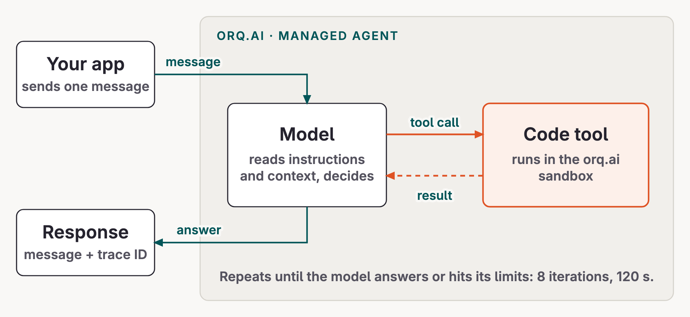
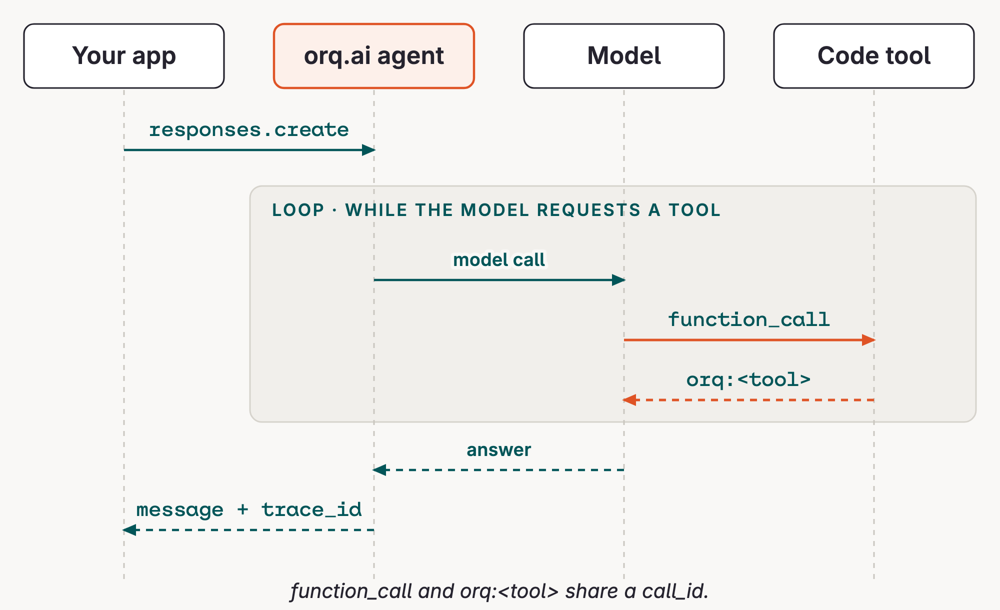
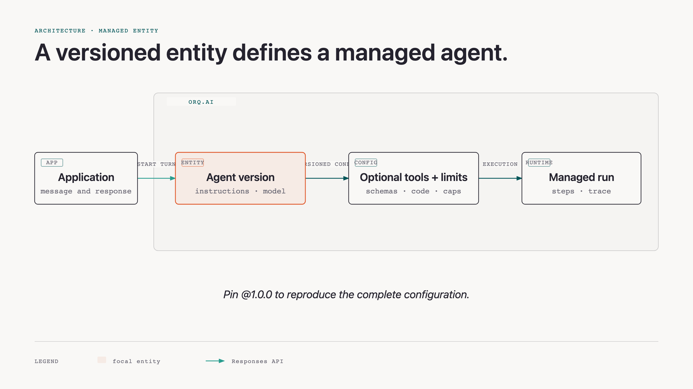

# Agent concepts

A managed agent combines a model's judgment with tools that enforce the business rules.

Start with this minimal illustration. It is not a second workshop entity to create; it gives the managed-agent loop a small, familiar shape before the refund case adds business requirements.

## What an agent is

An agent is a model, instructions, and optional tools running in a loop until it can answer. The model decides whether it has enough information, needs a tool, or should respond to the customer.

### A hello agent

```python {.code-frame}
# Illustrative configuration: no tools, one clear instruction.
hello_agent = {
    "instructions": "Greet the customer in one sentence.",
    "model": "provider/model",
    "tools": [],
}

# One managed-agent turn.
response = orq.responses.create(
    model="agent/hello-agent",
    input="Hello",
)
```

The instructions tell the model what to do; the model supplies the language. The application sends one input and receives one response. That is already a managed agent, even without tools.



### One simple tool call

Now give the model one illustrative `get_weather(city)` tool. If the customer asks about weather, the model can request the tool instead of guessing.

```python {.code-frame}
# The model asks for structured work.
{
    "type": "function_call",
    "name": "get_weather",
    "arguments": '{"city":"Paris"}',
}

# orq.ai executes the hosted tool and returns structured evidence.
{
    "type": "orq:get_weather",
    "result": {"temperature_c": 18, "condition": "clear"},
}
```

The important pattern is not weather. It is the loop: **model decision → tool result → model decision → answer**. The refund agent uses the same loop with business-specific tools.

## The loop orq.ai runs

Your application sends one customer message and receives one response. In between, orq.ai runs the model and the code tools in its sandbox. The result of each tool call is added to the model context before the next decision.

The refund agent stops when it answers, after `max_iterations: 8`, or after `max_execution_time: 120` seconds. Those are v1 configuration choices; see [Solution design](https://orq-ai.github.io/kickstarterai-techdays-workshop-2026/modules/02-solution-design/) for the prompt, tools, and full agent settings.

## One turn on the wire

A hello turn is one `responses.create(model="agent/hello-agent")` call. Its response contains a `message` item and `telemetry.trace_id`.

```python {.code-frame}
import os

from orq_ai_sdk import Orq

orq = Orq(api_key=os.environ["ORQ_API_KEY"])
response = orq.responses.create(
    model="agent/hello-agent",
    input="Hello",
)

message = next(item for item in response.output if item.type == "message")
print(message.content)
print(response.telemetry.trace_id)
```

When an agent has tools, the same response shape gains a `function_call` item with a name and arguments. orq.ai executes the hosted tool and adds an `orq:<tool>` item with the matching `call_id` and result before the final message. The refund solution uses that extended shape later.



## An entity with versions

A managed agent is an orq.ai entity containing instructions, a model, optional tools, limits, and versions. Pinning `@1.0.0` makes a call reproducible. Publishing a change creates a new version; there is no separate deployment to manage.

The important SDK distinction is **configuration versus invocation**. `orq.agents.create()` configures a durable entity. `orq.responses.create()` runs one turn against it. A workshop application should not rebuild an agent on every request.

```python {.code-frame}
# Configure once: an agent with no tools is still a managed agent.
orq.agents.create(
    key="hello-agent",
    description="Greets a customer in one sentence.",
    instructions="Greet the customer in one sentence.",
    path="Example/Agents",
    model="provider/model",
)

# Invoke many times, optionally pinning one version.
response = orq.responses.create(
    model="agent/hello-agent@1.0.0",
    input="Hello",
)
```



## Prompt guidance and tool evidence

A tool schema is a contract with the model: its name, argument shape, and description constrain what the model can request. The tool result is evidence the model can use in the next loop turn.

In the weather illustration, the prompt can decide **when** to ask `get_weather`. It cannot invent the weather result. The hosted tool returns structured data, and the model turns that data into a customer-facing answer. The refund solution applies the same separation to its business-specific policy tools.

## Next

Now apply this generic loop to the [Business case](https://orq-ai.github.io/kickstarterai-techdays-workshop-2026/modules/02-logic/). It defines the refund requirements that the v1 [Solution design](https://orq-ai.github.io/kickstarterai-techdays-workshop-2026/modules/02-solution-design/) must meet.

## Official docs

- [Build Agents](https://docs.orq.ai/ai-studio/ai-engineering/build-agents)
- [Create Tools](https://docs.orq.ai/ai-studio/ai-engineering/create-tools)
- [Run Agents](https://docs.orq.ai/ai-studio/ai-engineering/run-agents)
- [Responses API](https://docs.orq.ai/ai-gateway/features/responses-api)
- [Traces](https://docs.orq.ai/ai-studio/observability/traces)
