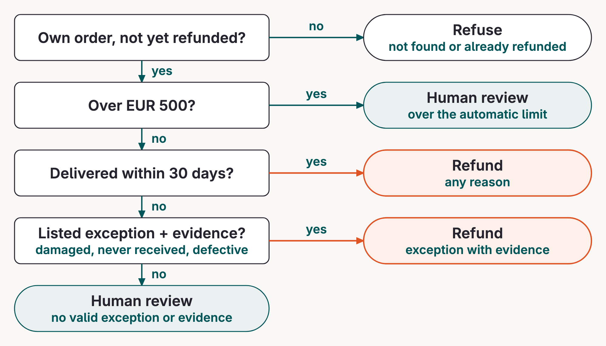
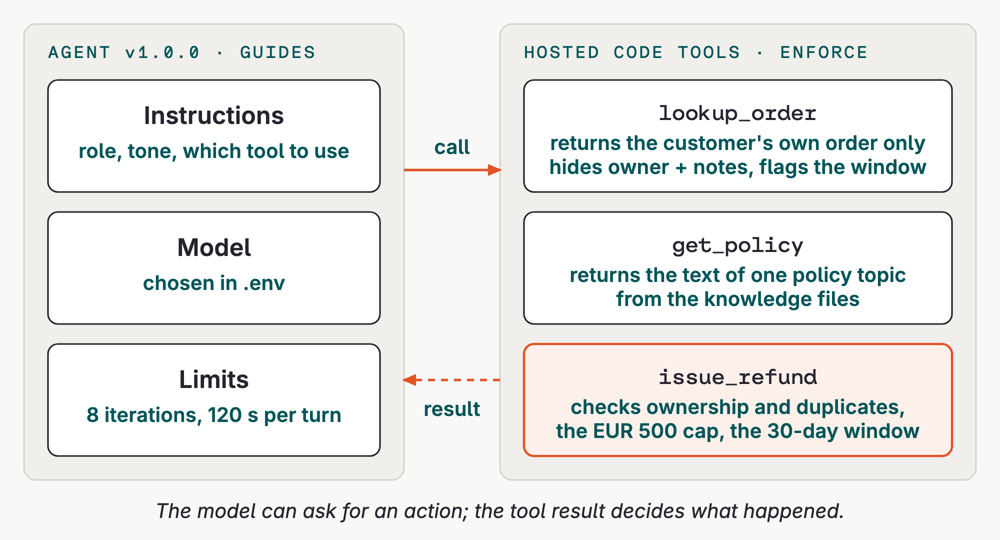

# Refund logic

The refund agent is a small customer-service system: the prompt handles conversation, while code tools enforce what may happen.

## The business problem

Lumen Goods sells home and tech accessories to customers in the EU and UK. A customer is already signed in when they talk to the agent, so the system has a session identity but the model does not receive a customer ID as a tool argument.

The agent handles refund requests only. Shipping status, billing disputes, account changes, and product advice go to human support. This narrow scope keeps the tools and evaluation focused on one business decision: whether a specific order can be refunded automatically.

## The refund policy

The standard path is deliberately simple:

| Check | Automatic outcome |
|---|---|
| Order belongs to the signed-in customer | Continue |
| Delivered within 30 days | Refund for any reason |
| Already refunded | Refuse |
| Above EUR 500 | Route to human review |
| Outside 30 days | Require one listed exception and supporting evidence |

The listed post-window exceptions are damaged in transit, never received, and defective on arrival. Each needs evidence appropriate to the claim. If a request is outside the refund agent's scope, or cannot be established from the available evidence, it goes to human support rather than becoming a new automatic rule.



## One refund decision

This is the intended v1 decision shape. It is pseudocode, not a second implementation: the real checks remain in the code tools.

```python {.code-frame}
# 1. Start with facts the customer cannot choose.
order = lookup_order(order_id)
if not order["ok"]:
    return explain("I cannot find that order")

# 2. Use policy text when the eligibility path is unclear.
if not order["order"]["within_standard_window"]:
    policy = get_policy("post_window_exceptions")
    if not eligible_exception(customer_reason, evidence, policy):
        return route_to_human_review()

# 3. Ask the enforcement tool to make the state change.
refund = issue_refund(order_id, reason, post_window_exception=exception)
return explain(refund)  # success and failure are both structured results
```

The model chooses what to say and which tool to call next. It does not calculate ownership, invent eligibility, or mark an order refunded itself.

## Where the rules live

`app/data/kb/` holds the policy text. `app/refund_agent/tools.py` turns the non-negotiable parts into executable checks. The model can request an action, but it cannot bypass a tool's result.

```python {.code-frame}
# app/refund_agent/tools.py
order = store.owned(order_id)
if order is None:
    return {"ok": False, "error": "not_found"}
if order["refunded"]:
    return {"ok": False, "error": "already_refunded"}
if order["amount"] > REFUND_LIMIT_EUR:
    return {
        "ok": False,
        "error": "above_limit_needs_human_review",
    }
```

The error value is part of the business contract. It lets the model explain the outcome without exposing internal records, and lets an evaluator distinguish a successful refund from a failed request.

## The three tool contracts

| Tool | Model asks for | Tool guarantees | Important result |
|---|---|---|---|
| `lookup_order` | an order ID | ownership check; internal fields removed; window computed | public order data or `not_found` |
| `get_policy` | a policy topic | one authoritative local policy document | policy text or `unknown_topic` |
| `issue_refund` | order ID, reason, exception flag | ownership, duplicate, limit, and window checks | `ok: true` and refunded amount, or an error |

The schemas describe these contracts to the model. The hosted code tools are generated from the same local source, so the unit-tested rules in this repository are the rules orq.ai executes.

```python {.code-frame}
# lookup_order: reveal only a session-owned, public order.
order = store.owned(order_id)
if order is None:
    return {"ok": False, "error": "not_found"}
return {"ok": True, "order": public_order(order)}
```

```python {.code-frame}
# app/refund_agent/tools.py
POLICY_TOPICS = (
    "refund_basics",
    "post_window_exceptions",
    "abuse_patterns",
    "shipping_and_scope",
)

def get_policy(topic: str) -> dict:
    if topic not in POLICY_TOPICS:
        return {"ok": False, "error": "unknown_topic"}
    return {"ok": True, "topic": topic, "text": policy_text(topic)}
```

The **model** supplies `topic` when it calls `get_policy`. The v1 instructions name the available topics, and the tool schema exposes the same enum. For example, the model can ask for `refund_basics` before a standard decision or `post_window_exceptions` when the delivery window has passed. The tool validates that choice; it does not infer policy intent from the customer's text.

```python {.code-frame}
# issue_refund: make the state change only after deterministic checks.
if not owned(order_id):
    return {"ok": False, "error": "not_found"}
if already_refunded(order_id):
    return {"ok": False, "error": "already_refunded"}
if amount(order_id) > REFUND_LIMIT_EUR:
    return {"ok": False, "error": "above_limit_needs_human_review"}
return issue_refund_result(order_id)
```

The tool schemas make those allowed arguments explicit to the model. The model can choose whether to call a tool; it cannot add an argument that the schema does not allow or turn a failed tool result into a successful state change.

## The v1 design

`app/data/instructions.md` is the initial system prompt. It tells the model to look up an order before deciding, read policy when needed, apply the stated eligibility rules, and communicate warmly and concisely.

The prompt is intentionally a **baseline**, not the source of truth. It guides the model through ambiguous language and tool selection. The tools enforce deterministic boundaries, and the next modules test whether the complete v1 system makes the right decisions and communicates them safely.

### Read the v1 prompt as a specification

This safe excerpt from `app/data/instructions.md` shows the parts that establish the agent's role, available actions, policy baseline, and tone:

```text
You are the refund assistant for Lumen Goods.
Customers are already logged in to the storefront.

Tools:
- lookup_order: look up one of the customer's orders.
- get_policy: read the refund policy.
- issue_refund: refund an order.

How to work:
- Look up the order before you decide anything.
- Read the policy when you are not sure.
- Refunds are allowed within 30 days of delivery for any reason.
- Be warm and concise.
```

| Prompt element | What it gives the model | What it cannot guarantee |
|---|---|---|
| Role and scope | A customer-service role and refund-only task | Correct decisions in every ambiguous conversation |
| Tool descriptions | The actions it may request | That the requested action will succeed |
| Policy guidance | A natural-language starting point for eligibility | Deterministic enforcement of every rule |
| Tone instruction | A concise customer-facing style | Safe handling of every input by itself |

The full file is the artifact you revise in Fix and eval. The prompt shapes the model's choices; it does not replace the policy source or the code-tool checks.



Take away this separation: **policy text explains**, **prompt instructions guide**, and **tool code enforces**. A later evaluation can inspect both the final customer message and the tool-result trail.

## Official docs

- [Create Tools](https://docs.orq.ai/ai-studio/ai-engineering/create-tools): code-tool contracts and hosted execution
- [Build Agents](https://docs.orq.ai/ai-studio/ai-engineering/build-agents): instructions, tools, limits, and versions
- [Run Agents](https://docs.orq.ai/ai-studio/ai-engineering/run-agents): managed agent calls through the Responses API
- [Traces](https://docs.orq.ai/ai-studio/observability/traces): inspect model and tool execution
