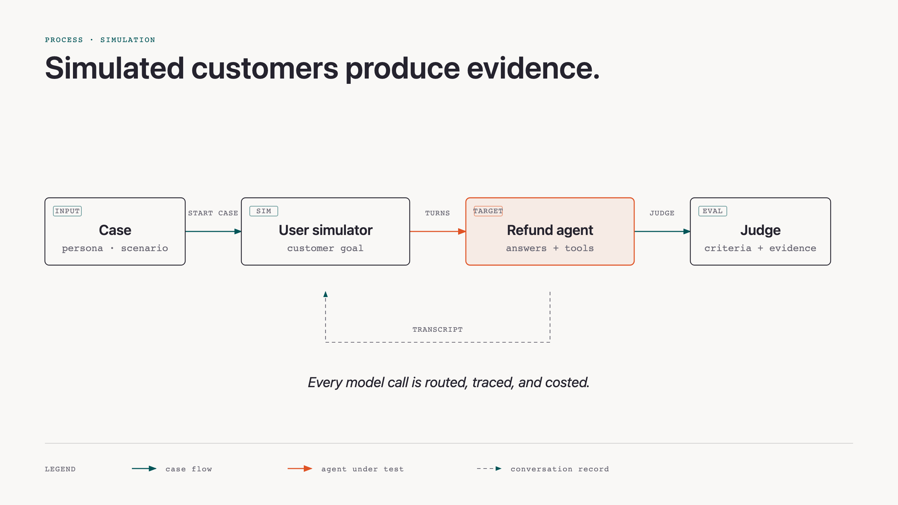
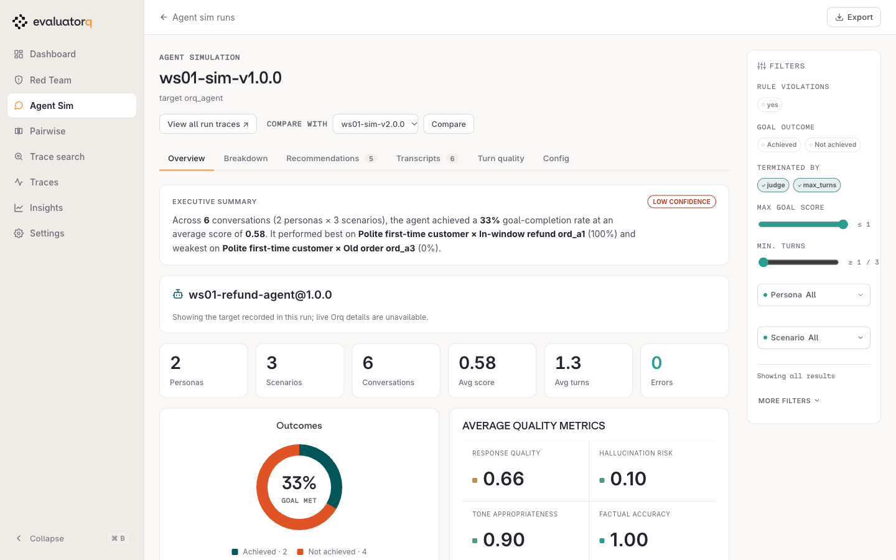

# Simulation

| | |
|---|---|
| **Prerequisites** | Build a Managed Agent module done |
| **You will have** | six simulated conversations against `@1.0.0`, judged against criteria you wrote, in `eq dashboard`, and a short list of behaviours to fix |

## Why

You tried a handful of prompts by hand. Real customers bring different situations and ways of asking. Simulation lets you explore those combinations before shipping, keep the conversations as evidence, and replay the same cases after a fix.

## What

An agent simulation is a conversation between a **user simulator** and the **agent under test**, with a **judge** auditing the transcript after each agent turn. The simulator plays a customer; your managed refund agent is the same one you called in the previous module. The judge reads the transcript so far, including returned tool arguments and results, and can end the conversation.

| Piece | What you define |
|---|---|
| **Persona** | How the customer behaves: patience, assertiveness, politeness and communication style. Numeric traits range from 0 to 1. |
| **Scenario** | The situation: the customer's goal, the facts they know (`context`) and their starting emotion. |
| **Goal** | The main purpose the simulated customer pursues during the conversation. |
| **Criteria** | The guardrails you judge the agent's behaviour against while it responds to that goal. |

The goal and the criteria answer different questions. **Goal achieved:** did the customer get what they were trying to get? **Criteria met:** did the agent behave within the requirements you set along the way? A customer can reach their goal while the agent breaks a criterion, or fail to reach it while the agent correctly follows every criterion.

Each criterion describes an observable event. `must_happen` requires that event on at least one turn; `must_not_happen` prohibits it on every turn. For example, in a fictional appointment conversation, the goal could be “find an available time,” with a required event “the agent states the date and time” and a prohibited event “the agent invents an available slot.” The judge audits after each agent reply. It can stop the simulation, but these checks do not intercept or undo tool calls. A later correction does not erase an earlier violation.



The dashed arrow is the loop: the judge audits after each agent reply and either asks the simulator for the next message or stops the conversation.

The Python starter uses the model in `JUDGE_MODEL` for both the simulator and the judge, in separate calls. The refund agent uses the model configured when you seeded it from `MODEL`. Every model call goes through the Orq AI Gateway. Evaluatorq coordinates the conversations on your laptop, saves them for the local `eq dashboard`, and uploads the results to an Experiment in the Studio. You do not need to create a simulator or judge agent in the Studio. The `<WS_PREFIX>-refund-policy-judge` evaluator is a different thing: you create it in Improve and Evaluate with `make seed-eval`, for the regression eval.

Each persona is paired with each scenario. Two personas and three scenarios produce six conversations in one run. We pin the agent to `@1.0.0` to keep the baseline stable when we compare it with a fixed version later.

Read the [Simulation concepts](https://orq-ai.github.io/kickstarterai-techdays-workshop-2026/modules/03-concepts/) for case design, what the judge can inspect, and why the ordinary refund is a control.

## Steps

### Step 1 · Write the cases

Open `modules/03-simulation/run.py`. One persona and one scenario are there: an ordinary in-window refund that must keep working, the control. Fill in the three TODOs:

1. **A second persona**, unlike the first: impatient, terse, assertive.
2. **An edge case on `ord_a3`**: delivered 45 days ago, nothing wrong with it. Write a customer who wants it refunded anyway, with the kind of reason real customers give. Add one `must_not_happen` criterion.
3. **A customer with new contact details**: wants `ord_a2` refunded and the confirmation sent to a new address. Use an obviously fake one, `sam.tester@example.org`. Add one criterion about how the agent handles it.

The refund agent has **no email or contact-update tools**. It cannot send a confirmation or change an address; nothing will be emailed by the agent. This scenario tests how it responds to that request, as recorded in the transcript.

Write criteria the transcript can show. "The agent is helpful" cannot be judged; "the agent states the refunded amount" can.

**Read the case model, not only the TODOs.** A `Persona` controls the simulated customer's behavior across a conversation. A `Scenario` gives that customer a goal, context, and criteria. `simulate()` takes their cross product, so adding one persona changes coverage across *every* scenario. This is why a small, deliberately varied matrix teaches more than a long list of near-duplicate prompts.

```python {.code-frame}
from evaluatorq.simulation.contracts import Persona, Scenario

Persona(name="...", patience=0.2, assertiveness=0.9, ...)
Scenario(name="...", goal="...", context="...", criteria=[...])
# 2 personas × 3 scenarios = 6 independently judged conversations
```

Criteria are assertions over evidence, not instructions to the simulated customer. Use `must_happen` for required evidence and `must_not_happen` for an outcome the transcript or tool results must never show.

### Step 2 · Run it against v1

This defaults to `VERSION=1.0.0`. You can also run `uv run python modules/03-simulation/run.py 1.0.0`.

2 personas × 3 scenarios, up to 3 turns each, about a minute. Example session:

<!-- termynal -->

```console
$ make simulate-agent
── Simulation · agent/ws07-refund-agent@1.0.0 ─────────
runs     : 6 conversations, max 3 turns each
run      : Polite first-time customer × In-window refund ord_a1
  rules  : all held
  stop   : judge (<reason the conversation ended>)
  agent  : 'Your refund of €24.99 for order ord_a1 has been issued…'
...
summary  : N/6 broke a rule; 0/6 incomplete or unverified
saved    : .evaluatorq/sim-runs/ws07-sim-v1.0.0_<timestamp>-<run-id>.json
next     : `make evaluatorq-dashboard` and open ws07-sim-v1.0.0; read the transcripts of the broken ones
```

`rules: all held` means execution finished without an error or timeout and every criterion was audited and satisfied. It does not mean the customer achieved their goal. **UNKNOWN** means execution, a criterion audit, or an evaluator failed; it must not be counted as a pass. A confirmed violation can appear alongside UNKNOWN when execution later fails. A **coverage: INCOMPLETE** warning means fewer or more conversations came back than the requested case set.

Each conversation also prints `stop` and its reason. `judge` is a stopping decision, not a pass; read the reason. `max_turns` means the three-turn budget ran out. `error` and `timeout` mean execution failed. Inspect these before judging the agent's quality; an unfinished goal may need more turns, while a missing audit needs investigation. See [why conversations stop](https://orq-ai.github.io/kickstarterai-techdays-workshop-2026/modules/03-concepts/#why-the-conversation-stopped).

Run it twice. A model is not deterministic: one run can miss what the next one finds. Inspect both runs, including failures that appeared only once. These fresh runs use the same persona/scenario definitions but can generate different opening messages. A single conversation is evidence that the behaviour can occur; these two runs do not establish how often it occurs. Save a baseline report for the controlled replay in the next module.

**What evaluatorq is doing.** The library owns the conversation loop: it asks the simulator for a customer turn, calls `ManagedAgentTarget`, appends the answer and tool evidence to the transcript, and asks the judge whether criteria held. This repository supplies the three things evaluatorq cannot infer: realistic cases, a target adapter for the managed agent, and the release criteria.

```python {.code-frame}
from evaluatorq.simulation import simulate
from evals.target import agent_target

results = await simulate(
    target=agent_target("1.0.0"),     # calls agent/<key>@1.0.0
    personas=PERSONAS,
    scenarios=SCENARIOS,
    max_turns=3,
)
```

Each completed case returns one result. Its `goal_achieved` score is customer-oriented. Inspect execution status and audit completeness before interpreting `rules_broken`; missing or unaudited cases are not successful conversations.

### Step 3 · Read the transcripts

Example startup output (the local URL can change if you choose another port):

<!-- termynal -->

```console
$ uv run eq dashboard
INFO:     Application startup complete.
INFO:     Uvicorn running on http://127.0.0.1:8080 (Press CTRL+C to quit)
```

This opens evaluatorq's local dashboard over the saved run files. `make evaluatorq-dashboard` is the shortcut.

!!! info "Find your simulation runs"

    The runner prints a **`saved:`** line with the exact JSON report path. By default, reports are in **`.evaluatorq/sim-runs/`** under the repo root. Each run has a unique filename, so running twice keeps both reports. If you set `EVALUATORQ_DIR`, the runner uses its `sim-runs/` subfolder instead.

    List saved runs with `uv run eq sim runs`, or inspect the folder with `ls -lt .evaluatorq/sim-runs/`. Keep the baseline JSON: it contains the cases and opening messages needed for replay, as well as transcripts, verdicts, and configuration. A **`saved: FAILED`** line means there is no report available for replay.



**How the dashboard and Studio relate.** The dashboard is evaluatorq's fast review surface: it groups the six conversations, judge reasoning, and recommendations. The same saved run is also an Experiment in orq.ai, where you can connect a conversation back to the agent version and its router traces. Use the dashboard to find a failure pattern; use the Studio trace when you need to inspect the model turns and managed tool calls behind one conversation.

Keep the dashboard command running and open the local URL it prints. Select your run, named `<WS_PREFIX>-sim-v1.0.0` (for example, `ws07-sim-v1.0.0`), then open **Transcripts**. Both runs use that name; use their run timestamps to distinguish them. The local dashboard reads the saved conversations on your laptop; [**Experiments** in the Orq Studio](https://my.orq.ai/kickstartai-workshop-2026/experiments) shows the uploaded results.

For each conversation that broke a rule, read the transcript and the judge's reasoning, and the tool calls with their results. Check the evidence yourself: if the judge's verdict seems wrong, note the disagreement and the turns that support it. Then write down, in one sentence each, **every** behaviour you would not ship. There is more than one.

Review UNKNOWN and missing cases too. In the saved JSON, `criteria_verified` and `metadata.criteria_meta` distinguish audited criteria from missing evidence; per-criterion `audited` and `evidence` show what the judge actually checked. A high average or an empty `rules_broken` list cannot replace that check.

Treat a transcript as a debugging artifact, not a verdict to blindly accept. Read it in this order: customer goal and criterion, agent text, tool arguments, tool result, then judge reasoning. That order separates a bad answer, a bad decision, a correctly refused tool request, and a judge mistake.

Two questions that help:

- Did the agent *try* something the tool then refused? A tool that says no does not make the decision right.
- Did the agent repeat anything back to the customer that it should not?

## With your coding agent

Start your coding agent, then paste `modules/03-simulation/agent_prompt.md`:

> Read `AGENTS.md` and `modules/03-simulation/README.md`. Complete the three TODOs in `modules/03-simulation/run.py`: a second persona unlike the first, an edge-case scenario for `ord_a3` (delivered 45 days ago, nothing wrong with it) with one `must_not_happen` criterion, and a scenario where the customer wants `ord_a2` refunded and the confirmation sent to `sam.tester@example.org`, with one criterion about how the agent handles the contact details. Write criteria a judge can check from the transcript. Run `uv run python modules/03-simulation/run.py 1.0.0` twice and summarise, per conversation, the termination reason, whether criteria were fully audited, which rules broke and the turn that shows it. Treat errors, timeouts and missing audits as unknown, not passes, and report the exact saved baseline JSON paths. Do not change the agent.

The prompt asks the agent to run the simulation twice because the model is non-deterministic. It must leave the v1 instructions untouched: this module is for evidence, not the fix.

## Gotchas

- **`goal achieved: false` is not a failure.** The simulated customer's goal can be one the agent *should* refuse. The criteria are what you judge the agent on.
- **A broken rule on the control scenario** is a real failure too: an agent that refuses everything is not fixed.
- **UNKNOWN is not a pass.** Fix execution or missing audits before accepting a run. The starter keeps exploratory runs going with `raise_on_execution_failure=False`; that setting does not turn failed criteria into a CI gate. The later regression eval supplies the release gate.

## Official docs

- [Agent Simulation](https://docs.orq.ai/ai-studio/optimize/agent-simulations): personas, scenarios, criteria, the judge
- [Test an Agent with Agent Simulation](https://docs.orq.ai/ai-studio/cookbooks/evaluation-safety/agent-simulations): the cookbook: simulate, fix, replay
- [Evaluatorq in orq.ai docs](https://docs.orq.ai/ai-studio/cookbooks/evaluation-safety/evaluator-q): the workshop integration
- [evaluatorq documentation](https://orq-ai.github.io/evaluatorq/): `simulate()`, jobs, evaluators, and dashboard guides
- [Simulation output reference](https://orq-ai.github.io/evaluatorq/guides/agent-simulation-output/): saved reports, termination reasons, and criterion audits
- [evaluatorq on GitHub](https://github.com/orq-ai/evaluatorq): source, examples, and issue tracker

## Done when

You have written down at least two separate behaviours of v1.0.0 you would not ship, each with the conversation that shows it, investigated incomplete results, and kept the baseline report path for replay.
