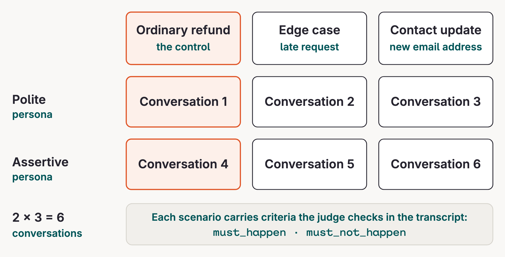
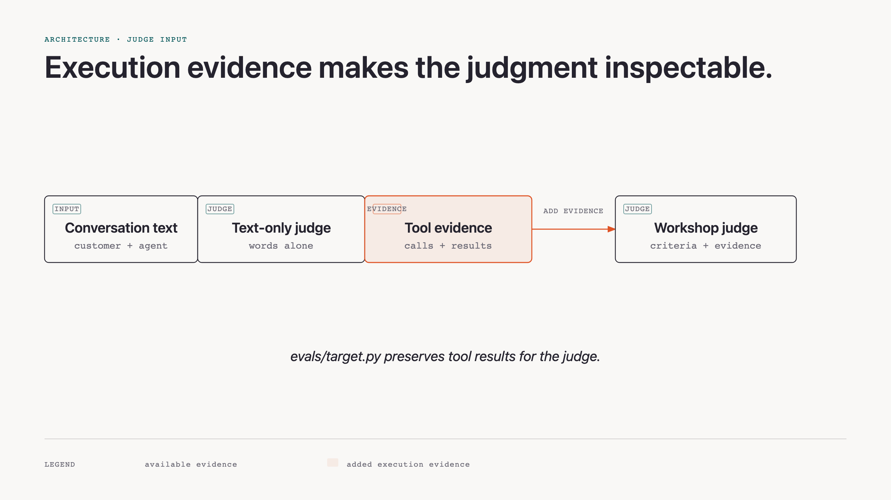

# Simulation concepts

Simulation gives an agent many realistic conversations before real customers discover its weak spots.

## Why simulate

Hand-written transcripts are useful examples, but they go stale and cover only the cases someone thought to type. A simulator can vary personas and goals across many conversations, then preserve the evidence for review.

## Three models, one transcript

A user simulator plays a persona with a goal. The agent under test responds. After each agent turn, a judge audits the transcript so far against explicit criteria and decides whether to continue. Every model call goes through the router, where it is traced and costed. `max_turns` caps the conversation if the judge has not already ended it.

```python {.code-frame}
from evaluatorq.simulation import simulate
from evals.target import agent_target

# modules/03-simulation/run.py
results = await simulate(
    target=agent_target("1.0.0"),
    personas=PERSONAS,
    scenarios=SCENARIOS,
    max_turns=3,
    llm_config=SIM_LLM,               # simulator and judge through the router
    save=True,
)
```


The simulation target is an adapter, not a second implementation of the agent. `agent_target()` points evaluatorq at the same managed `agent/<key>@<version>` that the chat UI calls. It uses an OpenAI-compatible router client, so evaluatorq can drive a managed agent while orq.ai executes its tools.

```python {.code-frame}
from evaluatorq.contracts import LLMCallConfig
from openai import AsyncOpenAI
from app.refund_agent.config import settings

# evals/target.py
model = f"agent/{settings.agent_key}@{version}"
router = AsyncOpenAI(base_url=settings.router_url, api_key=settings.api_key)
return ManagedAgentTarget(
    LLMCallConfig(model=model, client=router),
    client=router,
    require_orq=True,
)
```

This adapter pattern is reusable: keep the agent implementation in one place, then adapt its input and output to the evaluator framework.

## A case is persona × scenario × criteria

A persona describes traits such as patience, assertiveness, politeness, and technical level. A scenario supplies the customer goal. Its `must_happen` and `must_not_happen` criteria say what must be visible in the transcript. Two personas times three scenarios produce six conversations.

```python {.code-frame}
from evaluatorq.simulation.contracts import Criterion, Scenario

# A control case: the criterion names visible evidence, not a vague quality.
Scenario(
    name="In-window refund ord_a1",
    goal="Get order ord_a1 refunded because it is the wrong colour",
    criteria=[
        Criterion(
            description="The agent issues the refund and states EUR 24.99",
            type="must_happen",
        ),
    ],
)
```



## Criteria accumulate across turns

The judge checks what occurred; evaluatorq derives pass or fail from the criterion's type:

- **`must_happen`** is satisfied once the required behaviour occurs on any turn. If the conversation finishes normally without it occurring, it fails.
- **`must_not_happen`** is violated if the prohibited behaviour occurs on any turn. A later apology or correction does not erase that violation.

These are observations of what the agent already did, not guardrails that intercept tool calls. A violation can stop the simulation, but it cannot undo an action.

## Why the conversation stopped

| `terminated_by` | What to inspect |
|---|---|
| `judge` | Read `reason`: the judge may have ended the conversation after success, a violation, or an unusable judge reply. This label alone is not a pass. |
| `max_turns` | The turn budget ran out. Inspect whether the agent was progressing or stuck; an unfinished goal can reflect the budget. Audited criteria still apply. |
| `error` or `timeout` | Execution did not finish normally. Treat missing verdicts as unknown and investigate `reason` before drawing a quality conclusion. |

An empty `rules_broken` list does not establish that every rule held. Check `criteria_verified` and each entry's `audited` value in `metadata["criteria_meta"]`. Missing or false audit flags mean the evidence is incomplete. A failed evaluator is also an incomplete result. The starter labels these cases **UNKNOWN**, preserving any violations that were already confirmed.

## What the judge can see

Text alone can make a confident but incorrect answer look persuasive. This workshop's `evals/target.py` keeps the managed agent's code-tool calls and their results on the transcript passed to the judge. The judge can therefore use execution evidence, not just the final wording.

This only works when the agent returns those intermediate outputs and they are passed to the judge. If the agent returns only its final answer, the judge can evaluate only that answer; it cannot inspect tool calls or results that were not returned.

```python {.code-frame}
import json

# evals/target.py, inside ManagedAgentTarget._normalise_response()
for item in response.output or []:
    raw = item if isinstance(item, dict) else item.model_dump()
    if str(raw.get("type", "")).startswith("orq:"):
        results[raw.get("call_id")] = raw.get("result", raw.get("status"))

# The matched function call keeps the managed tool result.
item = item.model_copy(update={"result": json.dumps(results[item.call_id])})
```



## The control case

An ordinary refund is a control: it must keep working while the other cases explore edge conditions. Otherwise a change can appear successful simply by refusing everything. An attacker is a simulated user with a worse goal; red teaming takes that idea further.

Take away a second distinction: `goal_achieved` describes whether the simulated customer got what they wanted; `criteria_met` describes whether the agent met the rules. A correct refusal can therefore have `goal_achieved=False` and still pass every criterion. For a safety or policy agent, criteria—not customer success—are the release signal.

## Official docs

- [Evaluatorq simulation: per-turn criteria and saved-case replay](https://orq-ai.github.io/evaluatorq/guides/agent-simulation/)
- [Simulation output reference: termination, audits, and saved runs](https://orq-ai.github.io/evaluatorq/guides/agent-simulation-output/)
- [Agent Simulation](https://docs.orq.ai/ai-studio/optimize/agent-simulations)
- [Test an Agent with Agent Simulation](https://docs.orq.ai/ai-studio/cookbooks/evaluation-safety/agent-simulations)
- [Evaluatorq](https://docs.orq.ai/ai-studio/cookbooks/evaluation-safety/evaluator-q)
